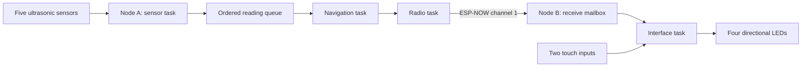
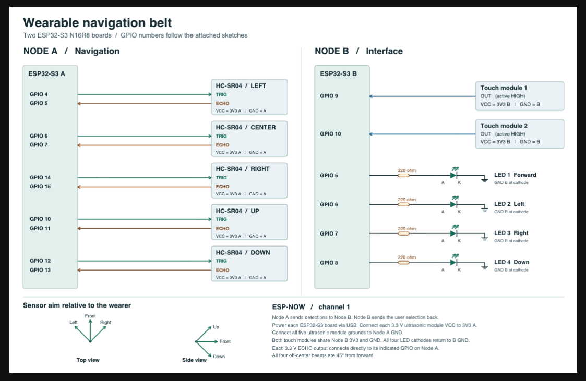
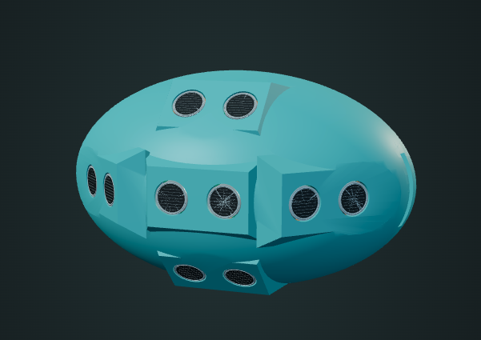

# BeltStick — Wearable Navigation System

**Authors:** Ayush Mittal · Anwesha Adhikari

An ESP32-S3-based wearable obstacle-awareness and local directional guidance prototype using five ultrasonic sensors, ESP-NOW and FreeRTOS.

> **Prototype status:** Firmware protocol version 3. Not a certified mobility aid. The supplied archive includes mechanical prototype images but no completed quantitative validation logs. LEDs are a demonstration interface; independent use by blind users requires accessible feedback and further safety validation.

## Architecture



- **Node A:** Interrupt-driven echo timing, ground calibration, obstacle hysteresis, personal-space heuristic, local path selection and wireless transmission.
- **Node B:** Packet validation, freshness checks, mode selection, nonblocking LED rendering and link-loss indication.
- **Mechanical design:** 180 × 110 × 65 mm belt enclosure; forward sensor and four peripheral axes at 45°. Printable housing and rear cover.
- **Final firmware:** No IMU library or IMU processing required. Older mechanical and electrical documentation may retain an unused IMU.

## Repository layout

```text
wearable-navigation-system/
├── firmware/
│   ├── navigation_node/navigation_node.ino
│   └── interface_node/interface_node.ino
├── hardware/pinout.md
├── cad/                       # STEP, STL, FreeCAD and preview files
├── docs/
│   ├── circuit_diagram.png
│   ├── circuit_diagram.pdf
│   └── images/
└── README.md
```

## Hardware and wiring

Two ESP32-S3 N16R8 boards, five ultrasonic modules, two digital-output touch modules, four LEDs with resistors, appropriate power supplies and level shifting as required.

| Node A sensor | TRIG | ECHO |
|---|---:|---:|
| Left | 4 | 5 |
| Center | 6 | 7 |
| Right | 14 | 15 |
| Up | 10 | 11 |
| Down | 12 | 13 |

| Node B component | GPIO |
|---|---:|
| Forward LED | 5 |
| Left LED | 6 |
| Right LED | 7 |
| Down LED | 8 |
| Mode 1 touch | 9 |
| Mode 2 touch | 10 |

**Electrical precautions:** Check the exact ultrasonic module voltage rating. Standard 5 V HC-SR04 modules need a suitable 5 V supply and ECHO level shifting to 3.3 V; never apply 5 V to an ESP32 GPIO. The firmware comments assume 3.3 V-compatible modules. Use common local ground and LED series resistors. Touch inputs are active-HIGH by default; change `TOUCH_ACTIVE_LEVEL` if necessary.



## Build and run

1. Install Arduino IDE and the ESP32 Arduino core 3.x.
2. Select the ESP32-S3 board configuration matching the N16R8 hardware.
3. Wire both nodes according to the tables above. No external IMU libraries are required by the final sketches.
4. Open and upload `firmware/navigation_node/navigation_node.ino` to Node A and `firmware/interface_node/interface_node.ino` to Node B.
5. Open both Serial Monitors at **115200 baud** (newline for Node A commands).
6. Both nodes use ESP-NOW channel 1. Node A broadcasts by default; optionally configure `EXPECTED_NODE_A` in Node B with the belt's station MAC address to avoid accepting another transmitter. This does not provide cryptographic authentication.
7. Wear the belt in its intended position, stand still on level ground and send `c` to Node A. Wait for eight stable DOWN echoes and successful calibration before testing forward guidance.
8. Use touch pads or Node B serial commands `1` and `2` to select a mode. Test only in a controlled, supervised environment.

## Operating modes

| State | LED indication |
|---|---|
| Mode 1 | Obstacle LEDs blink; center or up maps to forward |
| Mode 2 | One recommended forward, left or right LED blinks |
| Confirmed no path (Mode 2) | Steady DOWN LED: hold position |
| Unknown evidence or link loss | All LEDs double-flash |

Mode selection has a temporary flash/chase animation, which normal hazard or uncertainty changes can interrupt. Side guidance means turn in place and rescan. An unlit LED is not a guarantee of safety.

## RTOS and timing

| Task | Core | Priority |
|---|---:|---:|
| Node A sensor acquisition | 1 | 4 |
| Node A navigation | 1 | 3 |
| Node A radio | 0 | 2 |
| Node B interface | 1 | 3 |

The implementation uses a binary semaphore for echo completion, ISR-safe signaling, critical sections, ordered queues, latest-value overwrite mailboxes, single-owner state and periodic scheduling using `vTaskDelayUntil()`.

| Configuration | Nominal value |
|---|---|
| Sensor slot / full scan | 55 / 275 ms |
| Echo timeout | 25 ms |
| Obstacle enter / exit | Below 90 / above 110 cm |
| Mode 2 clearance | At least 150 cm, two echoes |
| Side personal-space band | 20 cm default; configurable 0–40 cm |
| Measurement expiry | 450 ms |
| Radio heartbeat / link timeout | 100 / 300 ms |
| Interface cycle / touch debounce | 10 / 50 ms |

The 26-byte packet contains protocol version, boot identifier, sequence, obstacle/clear/blocked masks, direction, reason and per-beam lifetimes. Timing values are firmware configuration, not benchmark measurements.

## Serial commands

| Node | Command | Action |
|---|---|---|
| A | `c` | Calibrate downward reference |
| A | `s` | Print latest status |
| A | `v` | Toggle continuous status |
| A | `l 20` / `r 20` | Adjust left/right band in cm |
| B | `1` / `2` | Select mode |
| B | `s` | Show status |
| B | `t` / `x` | Start/cancel lamp test |

## Mechanical assets



Use `cad/BeltStick_Assembly.step` for CAD assembly inspection or `cad/Housing.stl` and `cad/RearCover.stl` for printing in millimetres at 100% scale. Check transducer fit with `cad/Bore_fit_coupon.stl`; see `cad/Read_me.txt` for assembly details. Battery mounting and switch openings are not finalized.

## Validation and known limitations

Record measured range error, invalid-echo rate, obstacle-to-LED latency, ground calibration repeatability, path-selection results, wireless timeout/recovery, current draw and battery runtime. No results are claimed here without logs.

Ultrasonic sensing can miss certain objects and cannot guarantee drop-off detection. Belt tilt can alter the floor reference, and side-band suppression may hide actual obstacles. Mode 1 obstacle persistence can overlap Mode 2 clearance, which the receiver rejects; test this interaction before deployment. Lamp testing temporarily overrides regular output. The broadcast protocol is unauthenticated, and Wi-Fi sleep is disabled. Future work includes tactile/audio feedback, electrical and mechanical qualification, power optimization and supervised accessibility testing.

## Authors

Ayush Mittal and Anwesha Adhikari.
